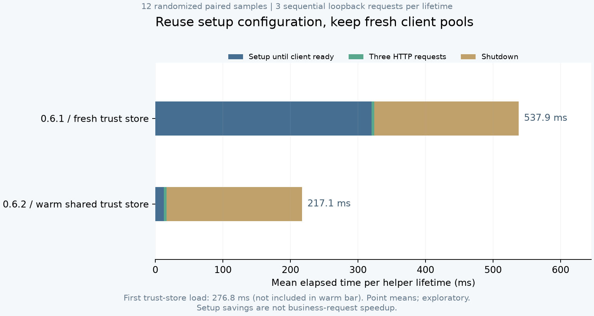
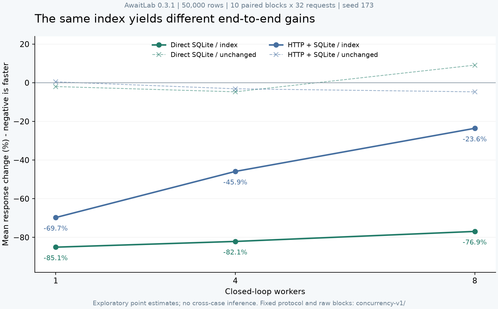

# 0.8 默认演示与Windows入口验证

日期：2026-11-15。SDK测量实现未改动，仍为0.8.0。本轮记录见 artifacts/default-refresh-v0.8.0.json。

全套105项单元/集成测试及87项浏览器检查通过；17个SDK源码/资源与已发布0.8 wheel逐字节一致，本轮未改变测量热路径。

- 三个入口设置局部环境、固定D盘TEMP/TMP和禁写字节缓存，使用pushd/popd恢复调用者工作目录；6项真实cmd回归通过。测试路径含中文、空格和&，覆盖缓存打开、缺报告测量、主动重跑、中途失败及不误开旧结果。GUI打开与pause被替换为记录，不声称实测了系统默认浏览器关联；默认HTML由Chromium实际渲染。
- 旧0.4 JSON/HTML归档到artifacts/history，原始字节SHA与Git LF规范化SHA分别记录；旧checkpoint仅在本机保留，不纳入仓库。新0.8 JSON/HTML同时保留latest和版本快照。
- 固定10配对、40请求、8并发、预热4、seed173，两个场景分别完成20对及完整恢复，比较数据不变，输出一致。直接SQL索引-79.11%、Holm p=.00390625；原实现-2.69%、p=.55859375。HTTP索引-12.78%、p=.00390625；原实现-.56%、p=.6484375。两个声明对照均未触发预设报警，不是等价证明。
- 不将独立重测解释为跨版本性能改进；校验干扰、短连接缓存和统计边界仍适用。历史0.8客户API与24批次求和数据保留，未覆盖。

## 0.8.0 SDK验证记录

日期：2026-11-15。汇总见 artifacts/validation-v0.8.0.json；完整解释与限制见 [METHOD-v0.8.md](METHOD-v0.8.md)。

- 99项单元/集成测试通过；最终Python元数据/文案改动后，9项角色测试与9项CLI测试再次通过。85项浏览器检查覆盖对照报警、候选推荐暂停、无报警不等价、未配置/旧数据角色、小p及短时延显示。
- 17个SDK/资源与wheel逐字节一致。独立-S环境的plan角色、原异常角色解释、32批次精确计数、33批次近似、核心2对与组合6对恢复及触达反例通过。HTTP用户项目8生命周期/4对恢复，对照角色与checkpoint身份保留且永不作为候选。

## 固定诊断及未解决的计时原因

使用冻结0.7.0安装包，原seed173、24配对、8请求、并发1；short、100倍工作量、50次预热、关闭采样4配置，各8次，按固定seed9137安排配置顺序。计划在开始测量前写入，SDK/wheel及驱动源SHA记录其中。

32次均未被运行内旧规则判为支持，包含原short的8次；32个对照raw p另作预定Holm family后也均无报警。所有结果和原始报告保留在 negative-control-diagnosis-v0.7.0/。没有改seed或补样直到复现，不能归因预热或采样，也不能证明原事件消失。这个诊断没有被算成0.8性能测量。

## 决策接缝与角色回放

新增显式Arm.role，默认candidate。角色进入plan及checkpoint；角色单独变化也拒绝恢复。负面对照保留在同一Holm family，不重算或剔除原p；原有evidence_level保留数值规则分级。负面对照永不作为candidate_improvement；两侧点变化越过预设门槛且精确调整p < alpha，或输出不一致，产生quality警告并暂停整轮候选推荐。

旧数据的确定回放先复现“unchanged被推荐”，回归测试在实际Experiment.run决策接缝失败；修复后通过。角色解释回放明确标为测后注释、无新测量，逐字段保留效应、区间、p和blocks，原文件SHA不变。原-7.50%/p=.012099266仍可核对；新解释为对照异常，两个推荐均为false。文件为control-role-anomaly-replay-v0.8.0，另保留真实诊断数据的no-alarm解释回放。

未报警不是等价证明，未配置不是通过，近似判定不伪装精确检查；对照语义由接入者预先声明，不根据名称猜测。报警也不确认具体计时原因。

## 原生运行与实际边界

预先声明角色的24批次新业务完成48对完整恢复，输出一致。公式候选-84.95%、Holm p=2.384185791015625e-7；对照-3.07%、p=.3560425043，未触发预设报警规则。数据在extended-exact-v0.8.0，不解释为计时异常已治好。

真实客户API完成40生命周期和20对完整恢复，业务投影一致；索引-50.78%、Holm p=.00390625，对照+12.97%、p=.05078125。严格规则未报警，不等于对照已证明稳定；这个相邻门槛的结果完整保留，未事后改变alpha。驱动峰值工作集约78.5MiB。见customer-api-v0.8.0与customer-lifecycle-check-v0.8.0.json。新unique-v0.8.0例子另验证原有未声明对照的接入，quality明确not_checked。

历史0.7计算成本、99 Fraction参考与32批次分布DP均保持原版本标记，未冒充0.8重测。0.8 SDK发布时默认入口仍显示历史SQLite报告，本轮已单独更新，见上面的入口验证记录。

## 0.7.0 历史验证记录

日期：2026-11-15。汇总见 artifacts/validation-v0.7.0.json，数学及算术版本说明见 [METHOD-v0.7.md](METHOD-v0.7.md)。

- 90项单元/集成测试、65项浏览器检查通过。新增覆盖Fraction独立枚举、零/重复权重、容差邻点、解析大n尾部、32批次独立分布DP、浮点有限零假设、MC相同整数统计量及上限边界。
- 安装包17个SDK/资源文件逐字节一致。独立D盘、禁用site-packages时，32批次返回精确2/2^32、33批次返回带非零修正的近似p；CLI预览、核心2对、组合6对恢复和触达反例仍通过。HTTP用户项目8生命周期/4对恢复通过。

## 计数与数值边界

99组Fraction逐项参考、4组最多32批次的二项式计数均一致；另用独立Fraction动态规划核对实际32批次夹具，856个不同和的分配重数合计2^32，尾部13,473,302，与新算法一致。原始记录 integer-tail-validation-v0.7.0.json。

新版在差值的精确整数和上应用容差，旧版先fsum舍入再比较；容差邻点中2组p从.5变为1，符合独立Fraction参考。没有宣称全域与旧算法逐位等价。输入减法、时钟与均值已有精度不被恢复；JSON保存sum_arithmetic/algorithm。旧报告与断点不会混作新版重算。

## 配对成本与内存

冻结0.6.4 statistics.py及wheel SHA见 benchmarks/baseline-v064-statistics.json。固定seed2409、12随机配对，原始值在 randomization-cost-v0.7.0.json：

| 配对批次 | 旧/新耗时ms | 比较范围 |
| --- | --- | --- |
| 8 | .203095 / .011464 | 同夹具精确尾部计数相同 |
| 12 | 3.882523 / .032675 | 同夹具精确尾部计数相同 |
| 16 | 73.351600 / .141242 | 同夹具精确尾部计数相同 |
| 24 | 117.336100 / 1.486125 | 旧近似、新精确；仅描述 |
| 32 | 153.867783 / 26.382367 | 旧近似、新精确；仅描述 |

3个精确对精确主比较经Holm调整p均.00146484375；16批次耗时差95%配对bootstrap区间[-76.516,-70.507]ms。不是业务响应加速，区间也不是同时覆盖保证。

32批次Python追踪分配峰值约6.98MiB，相比旧近似约5KiB；每种模式一个新进程的描述性峰值工作集约27.8/51.6MiB，包含导入、10次调用和单独tracemalloc探针。没有内存推断或普遍上界；见randomization-memory-v0.7.0.json。PNG/SVG图区分了不同精度模式。

## 实际接入与负面对照异常

固定24批次的新求和实验输出一致、48对恢复成功。公式候选-85.68%、Holm p=2.384185791015625e-7；原实现对照也为-7.50%、p=.012099266，既有规则标为支持。原始 extended-exact-v0.7.0.json/HTML保留，没有为了消除这个反例而重抽seed或补样；它暴露极短约50微秒负载的收益解释风险，原因尚未确认。计算计数正确不等于测量无干扰，也不等于业务代码确被优化。

真实客户API沿用固定协议完成40生命周期和20对恢复，业务投影一致；索引-52.23%、Holm p=.00390625，原实现对照+2.27%、p=.54296875、未观察到收益。驱动峰值约78.4MiB。见 customer-api-v0.7.0 与 customer-lifecycle-check-v0.7.0.json；两份对照结果都保留，不只取较好的一份。后续优先诊断极短负载的测量干扰与负面对照呈现。

## 0.6.4 历史验证记录

日期：2026-11-15。汇总见 artifacts/validation-v0.6.4.json。

- 83项单元/集成测试、61项浏览器检查通过。新增检查覆盖严格alpha边界、分辨率不等于功效、近似检验上限、无替换候选、预览不调用负载/prepare/校准/测量且不创建目录。
- 17个安装SDK/资源文件逐字节一致。独立D盘禁用site-packages时，--plan输出与实际报告的设计信息一致，未创建预览输出目录；核心2对、组合6对恢复及4种触达反例仍通过。HTTP用户项目8生命周期/4对恢复通过。

## 离散分辨率与固定方案

双侧配对符号翻转检验包含观察到的符号分配及其整体反转，因此n批次的理论最小原始p为2/2^n。Holm的首步拒绝至少要求m倍该p严格低于alpha；这是当前候选组能否产生任何支持结论的必要条件，最佳情况下可达到。零差值、并列和实际噪声可以使p更大；不据此计算统计功效或保证实用改善。

benchmarks/inference_resolution.py枚举n=2..12，m=1/2/3/8，alpha=.01/.05/.0625/.1，共176个设计组合：实际精确符号枚举的全负非零差值、实际Holm调整与设计下界和可行性一致。严格边界另有单测。原始记录 inference-resolution-v0.6.4.json。不是采样模拟或从已测结果挑选配置。

CLI新增--plan；内置场景不会prepare或执行workload，也不校准、读写checkpoint、创建输出目录。自定义Python模块仍按正常导入执行顶层代码。正式运行前给出限制提示，SDK可主动调用experiment.inference_design()；完成报告保存inference_design可选元数据，不改既有evidence_level规则，不悄悄改变默认批次数。旧数据不推造设计证据。

真实标准库求和案例：6配对、2候选、每批8请求、并发1、预热1。sum(range(n))替换为已知求和公式，完整整数输出一致，平均响应下降84.15%；原始p=.03125、Holm p=.0625，仍为inconclusive。原实现对照+.09%，p=.96875。12对恢复后比较数据不变。该求和负载只验证提示与分类，不外推为业务场景收益。原始 resolution-v0.6.4.json/HTML，方案预览 resolution-plan-v0.6.4.json；没有因为分辨率不足而续加样本。

当前精确枚举上限16与检验共享常量。超过上限时明确只报告近似p，不自动授予支持；预览也说明此政策。最少理论批次数仅在当前精确范围内计算，不建议截取已有数据或反复增样。

真实客户API沿用固定0.6协议完成40生命周期和20对恢复，投影一致。索引-55.00%、Holm p=.00390625；原实现对照-2.69%、p=.4140625，未过点估计门槛。驱动峰值约78.9MiB。见 customer-api-v0.6.4 与 customer-lifecycle-check-v0.6.4.json；这确认新增CLI准备顺序没有破坏实际资源路径，不作跨版本加速比较。历史算法与微基准数据仍以原版本标注。

## 0.6.3 历史验证记录

日期：2026-11-15。汇总见 artifacts/validation-v0.6.3.json。

- 78项单元/集成测试、51项浏览器检查与640组区间布局/并集检查通过。新增检查覆盖逐站点触达、失败断点只留完整配对、上下文过期/嵌套重入、退出后不再注入延迟、捕获上下文不保留创建者Task。
- 安装包17个SDK/资源文件逐字节一致。独立D盘禁用site-packages运行：核心恢复2对、组合恢复6对且逐站点次数保留、4种未触达反例均拒绝。正常HTTP8生命周期/4对恢复，信任配置检查通过。

## 触达误判的冻结基线与修复

benchmarks/baseline-v062-reach.json记录0.6.2 wheel和experiment/trace源码SHA。replacement_reach.py的4个门禁案例使用同一当前追踪器，仅切换冻结/当前Experiment：主站点未执行、只在预热执行、只有同名观测跨度、只在清理执行，均由另一个站点产生替换调用。旧门禁接受，当前门禁拒绝；这比较的是门禁逻辑，不冒充整套旧SDK的重放。

同一脚本另独立比较冻结/当前trace：Session退出后重新附加捕获上下文并调用操作，旧版仍替换和记录，新版执行原函数、不记录且无法重新捕获有效上下文。初次发现清理污染的原始记录保留在 replacement-reach-initial-v0.6.3.json，最终在 replacement-reach-v0.6.3.json。这里不作性能结论。

schema4增加可选replacement_calls_by_site与comparison.replacement_sites，总replacement_calls保留。计数是实际分派尝试，并非成功完成次数。主站点每块必须非零；其他声明站点可以未执行。上下文到期后不开始新的观测/替换/延迟；已经开始的跨度仍正常结束，不把整段强行裁成测量窗口。报告明示整个配置的效果，旧多站点记录缺逐站点证据时不授予绿色支持状态，明确单一站点可从旧总数归属。

## 成本与真实算法示例

replacement_counter_cost.py固定12配对、每样本100000空异步调用、seed2121，随机顺序，核对返回值及计数。原始文件 replacement-counter-cost-v0.6.3.json：

| 模式 | 冻结/当前微秒每调用 | 差值95%区间，微秒 | Holm p |
| --- | --- | --- | --- |
| 聚合追踪 | 1.802 / 2.027 | [.040,.398] | .03564453125 |
| 实际替换 | 1.819 / 2.049 | [.099,.335] | .013671875 |

正确性修复在本机空调用上增加约0.23微秒（约12.5%），不是速度优化；不外推为真实业务同比减速。有效期修复前的同协议初测另存replacement-counter-cost-initial-v0.6.3.json，不挑较小结果替代最终源码的测量。

events_bundle_case使用3000个整数事件、1000个不同ID：列表扫描替换为保序哈希去重，重复count替换为Counter。10配对、每批8请求、并发1、预热1、seed173，全部保序ID和频次一致。only_unique响应24.743→16.518ms（-33.24%），only_count 23.606→7.232ms（-69.36%），组合23.347→.431ms（-98.15%）；固定3候选Holm p均.005859375。这是标准算法替换，不是工具自动生成优化；各臂独立配对，不将百分比相加。组合两个站点各80次，30对完整恢复保留明细。原始JSON与离线HTML为events-bundle-v0.6.3；有效期修复前的初测单独保留，不作版本速度比较。

真实客户API沿用0.6协议再完成40生命周期与20对恢复，业务投影一致；索引候选-52.45%、Holm p=.00390625，原实现对照-.48%、p=.8828125，未达点估计门槛。驱动峰值工作集约78.3MiB（包含导入与全部生命周期，不是独立服务内存或通用上界）。见customer-api-v0.6.3与customer-lifecycle-check-v0.6.3.json；不作跨版本加速推断。

## 0.6.2 历史验证记录

日期：2026-11-15。原始汇总见 artifacts/validation-v0.6.2.json。

- 67项单元/集成测试、42项浏览器检查与640组区间布局/并集检查通过。
- 新增配置复用检查：CERT_REQUIRED、主机名验证启用，验证标志、最低TLS版本和完整CA证书集合等同HTTPX新建默认配置；多次辅助器仍得到不同客户端，并逐一关闭。
- 安装包17个源码/资源逐字节一致。独立用户项目中核心禁用site-packages（含certifi不可用）仍运行、恢复并拒绝孤立Task；HTTP模块8生命周期/4对恢复、默认信任设置与配置复用检查通过。

## 重复准备成本的配对验证

冻结0.6.1 wheel的local_http.py，SHA见 benchmarks/baseline-v061-http.json。12配对、seed409；双方辅助器各预热一次，再随机先后运行。每个生命周期新建应用与HTTPX客户端/池，实际发送3个本机请求，核对响应、单连接复用、启动/关闭与票据归零。原始记录见 artifacts/http-setup-v0.6.2.json。

| 阶段，均值ms | 冻结0.6.1 | 0.6.2配置已加载 |
| --- | --- | --- |
| 客户端构造（独立探针） | 299.150 | .131 |
| 辅助器入口到客户端就绪 | 319.842 | 12.626 |
| 3个顺序HTTP请求 | 4.088 | 3.880 |
| 关闭 | 213.934 | 200.633 |
| 辅助器完整周期 | 537.864 | 217.139 |

客户端构造差值95%配对bootstrap区间[-311.913,-286.949]ms，辅助器就绪差值区间[-316.107,-298.162]ms；两个预定主比较的精确随机化p经Holm调整均为.0009765625。区间不是同时覆盖保证，全部仍属本机探索性证据。请求和关闭阶段仅描述，不给推断性加速结论。

首次SSL配置构造276.841ms独立记录，未包含在“配置已加载”的柱中；首次使用仍付这项成本。辅助器计时不含FastAPI路由构建，测试应用没有SQL业务；不能外推为业务响应快了96%。配置使用HTTPX默认的certifi信任集合，进程内固定快照复用；应用、客户端、连接池与生命周期未复用。

共享SSL配置的依据与限制见 [HTTPX官方配置示例](https://www.python-httpx.org/advanced/ssl/) 和 [Python SSLContext共享说明](https://docs.python.org/3.13/library/ssl.html#ssl.SSLContext)。仅在内部配置保持固定的前提下复用。此辅助器服务于本机明文HTTP实验，未新增远程HTTPS服务测试支持。

## 新进程与真实客户接口

分进程、各12个生命周期（包括首次配置构造）：阶段总耗时旧版约6416ms，新版约3073ms；整个驱动进程峰值工作集分别约64.1与61.6MiB。这是每种配置一个新进程的描述值，没有内存推断或通用内存上界。原始记录在 http-setup-memory-v0.6.2.json。

相同0.6客户协议（10配对、24请求、4并发、预热2、seed173）再验证40生命周期和20对完整恢复，业务投影一致；当前索引候选-55.52%、Holm p=.00390625，原实现对照-5.27%、p=.193359375，证据不足。对照虽越过5%点估计门槛，仍不会标为支持。驱动进程峰值约78.7MiB。见 customer-api-v0.6.2.json / HTML 与 customer-lifecycle-check-v0.6.2.json。

这些客户结果与旧版本未做同进程配对，不解释为版本导致的请求加速；本轮版本加速证据仅来自上面配对的准备阶段。所有旧版数据保留。

## 0.6.1 历史验证记录

日期：2026-11-15。原始汇总见 artifacts/validation-v0.6.1.json。

- 65项单元/集成测试、42项浏览器检查、640组区间布局/并集检查通过。新检查覆盖丢引用Task、有限后继清理、512完成任务释放、原有eager factory衔接以及真实ASGI lifespan遗留任务。
- 安装包17个源码/资源逐字节一致；独立D盘、禁用site-packages的安装环境运行同一GC探针，正确拒绝并以CancelledError结束孤立Task，无销毁警告，无关任务保持运行。普通HTTP用户项目8生命周期/4对恢复也通过。记录见 artifacts/install-check-v0.6.1.json 与 install-http-check-v0.6.1.json。

## 有证据的遗留任务修复

冻结0.6.0 wheel中的ownership.py，SHA见 benchmarks/baseline-v060-ownership.json。benchmarks/ownership_gc.py 仅切换所有权登记器，构造一个等待私有Event、没有调用方强引用的Task；请求中强制GC。

- 旧登记器：Task在两次请求中均已消失，finally收到GeneratorExit，循环记录pending-task被销毁；控制块却返回成功。
- 当前登记器：Task在GC后仍存在，块退出时取消，finally收到CancelledError；块因遗留任务被拒绝，无销毁警告，外部任务不受影响，原task factory恢复。
- 原始记录分别保留在 artifacts/ownership-gc-v0.6.0.json 与 ownership-gc-v0.6.1.json。

新实现只在任务未完成时持有引用，由完成回调移除；不保留整个运行的完成任务。对取消过程中产生的有限新任务继续清理。合作式取消仍是前提，不提供对任意非合作应用的强制终止保证。官方原理参考 [Python 3.13 asyncio.create_task](https://docs.python.org/3.13/library/asyncio-task.html#asyncio.create_task)。

## 成本与真实接口复验

12随机配对、seed1807、每组4096任务/64任务一波，包含Task创建、gather、调度和登记开销；候选与冻结旧版按随机先后运行。原始记录：artifacts/task-ownership-v0.6.1.json。

| 模式 | 旧/新微秒每Task | 差值区间，微秒 | Holm p |
| --- | --- | --- | --- |
| 立即返回 | 2.797 / 3.189 | [.351,.425] | .0009765625 |
| yield一次 | 3.856 / 4.083 | [-.186,.466] | .296875 |

立即返回模式点估计成本约+14%，绝对值约+.39微秒/Task；yield模式证据不足，不能解释为等效或确定变慢。不是业务请求同比变化。复用回调上下文的变体未形成可靠整体收益，未加入产品；其原始数据与当时源码另保留在 task-ownership-shared-context-v0.6.1.json。

正常动态客户API按相同固定0.6协议再测：40个生命周期均正确关闭，20对完整恢复没有新应用启动；索引候选响应变化-51.21%，Holm p=.00390625，原实现对照+0.57%、p=.904296875。已测业务投影一致，完整输出范围同下文。驱动峰值工作集约79.8MiB。数据见 customer-api-v0.6.1.json / HTML及customer-lifecycle-check-v0.6.1.json。与旧版不是同进程配对比较，不把百分比差别说成版本性能提升。

## 0.6.0 历史验证记录

日期：2026-11-15。原始汇总见 artifacts/validation-v0.6.json。

- 60项单元/集成测试、42项浏览器检查与640组区间布局/并集校验通过。
- 真实startup资源就绪后才接请求，块内HTTP连接复用；shutdown失败、原始ASGI未发送失败消息而抛异常、startup失败均拒绝测量。启动中取消、关闭中取消及原业务异常均保持正确，生命周期任务完成清理。
- 没有调用模型API；全程本机loopback与现有依赖。核心安装包禁用site-packages，标准库用户模块导出/恢复仍通过；包17个源码/资源逐字节一致。
- 安装包在独立D盘HTTP用户项目中完成8个生命周期、4对恢复，所有HTTP客户端关闭、票据归零、比较数据不变。记录见 artifacts/install-check-v0.6.json 与 artifacts/install-http-check-v0.6.json。

## 真实动态响应与资源生命周期

入口examples/customer_api_case.py。相同5万行SQLite数据；10配对、24请求、4并发、预热2、seed173，固定索引候选和原实现对照。原始数据见 artifacts/customer-api-v0.6.0.json，资源记录见 artifacts/customer-lifecycle-check-v0.6.0.json。

| 候选 | 平均响应变化 | Holm p | 本轮状态 |
| --- | --- | --- | --- |
| 索引查询 | -48.40% | .00390625 | 支持继续验证 |
| 保持原实现 | -2.04% | .51171875 | 未达点估计门槛 |

索引臂平均11.0434ms → 5.6989ms。响应始终生成动态request_id与served_at_ns，接入代码明确投影HTTP状态和完整customers列表。已测投影输出一致，不是整个HTTP响应体等价。单元测试另显示原始响应因元数据不同而不一致，改动客户余额仍会触发invalid_output。

40次应用生命周期均记录startup=shutdown=1，每次26请求（含2预热）、4条HTTP连接复用、客户端关闭、待用票据0。恢复全部20对测量时，应用生命周期审计没有新增记录，比较数据逐项相等。导入与源码/数据预检仍可能发生，不能将恢复解读为完全零I/O。

数据库执行器在应用lifespan中持有，SQLite仍为每查询独立只读连接；OS缓存协议沿用双文件完整读取与双路径线程预热。依赖版本fastapi0.141.1/httpx0.28.1/uvicorn0.52.4与数据文件摘要纳入案例版本。不是长连接SQLite池、多worker或远程服务。

整个验证驱动进程峰值工作集约80.5MiB，结束RSS约69.6MiB，含导入、驱动与所有生命周期，不含浏览器与OS文件缓存；不是独立服务内存上界。

绑定依赖版本前的首轮结果另保留在 artifacts/customer-api-initial-v0.6.0.json 与 customer-lifecycle-initial-v0.6.0.json。业务参数、seed未更改，最终运行在入口版本明确绑定后重新执行；不合并两轮作确认性统计。所有结果仍属本轮探索性证据。与0.4的8并发样例负载不同，不把差异说成版本带来的整体加速。

## 0.5.0 历史验证记录

日期：2026-11-15。原始汇总见 artifacts/validation-v0.5.json。

- 49项单元/集成测试、37项浏览器检查与640组区间布局/并集校验通过。
- 自定义模块在独立业务目录导入helper，真实替换调用次数与输出核对正确，完整恢复后comparisons不变。
- 入口配置文件变化、外部数据版本缺失均拒绝运行/恢复；测量中修改补充source_files，最终断点状态failed，完成配对保留但不输出完成报告。
- 安装包在独立D盘用户项目用 `python -S -m awaitlab run my_case` 执行，禁用site-packages；fastapi/httpx/uvicorn均不可导入，仍能运行算法工作负载、导出离线HTML、恢复2对完整数据。wheel17个源码/资源文件逐字节核对。详情见 artifacts/install-check-v0.5.json。

## 实际算法模块

入口：examples/unique_case.py；输出：artifacts/unique-latest.json / HTML。3000个整数ID、1000个不同值，固定request ID映射；10配对、12请求、并发1、预热2、seed173。原实现是列表成员检查，候选是保留首次出现顺序的dict.fromkeys。

当前均值6.9364ms → 0.2361ms，变化-96.60%，配对均值差95% bootstrap区间[-6.7330,-6.6704]ms，精确随机化p=.001953125（一个替换臂，无额外倍数）。完整已测输出一致。恢复10个完整配对，原始比较数据未改变。

这是标准算法在特定整数输入上的替换样例，不是原创去重算法或工具自动生成的优化。同步CPU工作在事件循环中执行，明确设并发1；不表示CPU并行、生产到达率或其他数据类型效果。输出校验仍即时执行，报告保留周期与校验段观测。

首轮（尚未跳过纯替换定时校准）结果另存 artifacts/unique-initial-v0.5.json；最终入口变化后按相同固定业务配置重新运行，没有挑选seed。全部结果仍属探索性，未对历史反复开发的完整搜索做校正。

## 0.4.1 历史验证记录

日期：2026-11-15。原始汇总见 artifacts/validation-v0.4.1.json。

- 45 项单元/集成测试、33 项浏览器检查与640组区间布局/并集校验通过。
- 实际CLI新增保存失败恢复检查：JSON与完整断点已保存，HTML目标被目录占用导致退出1；移除测试创建的空目录后 --resume，复用全部4对数据、未发起新配对、原始comparisons逐项相等，最终HTML包含新报告模块。
- 独立D盘安装运行SQLite、导出HTML、恢复4对测量；wheel中17个源码/资源逐字节一致，详见 artifacts/install-check-v0.4.1.json。

## 减少临时分配的配对微基准

对照取自0.4.0 wheel中的trace.py，包与文件SHA记录在 benchmarks/baseline-v040-manifest.json。只规范化换行，冻结代码在 benchmarks/baseline_v040_trace.py。候选仅在首次出现跨度键时构造统计字典，避免命中已有项仍分配默认字典。

同进程12配对、seed991，三模式随机顺序，双方随机先后。返回值校验、操作计数与采样上限均核对；构造装饰器不计入。原始数值见 artifacts/trace-allocation-v0.4.1.json。

| 模式 | 对照/候选微秒每调用 | 平均变化 | 差值95% bootstrap区间，微秒 |
| --- | --- | --- | --- |
| 聚合，100,000次 | 1.848 / 1.701 | -7.92% | [-.188, -.104] |
| 4096条采样上限，30,000次 | 2.033 / 1.868 | -8.10% | [-.214, -.127] |
| 4000个不同操作名 | 1.954 / 1.933 | -1.10% | [-.128, .060] |

前两种精确随机化p经三模式Holm调整均为.00146484375；冷名字模式调整p=.775390625，差值区间跨零，未宣称收益或等效。采样上限模式大部分调用在达到上限后只更新聚合，不代表每条跨度都写记录的成本。

只表示本机已标记空函数与驱动循环的时间，不能外推成生产服务约8%加速。0.4业务样例保持原测量版本，没有为补丁重新挑选漂亮业务数字。

## 0.4.0 历史验证记录

日期：2026-11-15。原始汇总：artifacts/validation-v0.4.json。

- 44 项单元/集成测试、33 项浏览器检查通过；640 组区间分轨与并集同时通过独立最大重叠/占用窗口校验。有限随机化自检沿用已验证协议。
- 新增慢校验测试，核对 worker 周期均值等于业务响应均值加校验段均值，整批 wall 包含校验，完整请求指纹保留。
- wheel 中 17 个源码/资源文件与当前项目逐字节一致。独立 D 盘安装执行真实 SQLite、导出含新报告模块的 HTML，恢复 4 对完整配对。详情见 artifacts/install-check-v0.4.json。

## 新版真实查询复验

仍为 5 万行、10 配对块、每块 40 请求、并发8、warmup4、seed173，固定索引候选与原实现对照。

| 链路 | 实现 | 平均响应变化 | Holm p | 本轮状态 |
| --- | --- | --- | --- | --- |
| 直接 SQLite | 索引版 | -83.09% | .00390625 | 支持继续验证 |
| 直接 SQLite | 原实现对照 | -1.53% | .4765625 | 未达点估计门槛 |
| HTTP → SQLite | 索引版 | -27.70% | .00390625 | 支持继续验证 |
| HTTP → SQLite | 原实现对照 | +0.17% | .923828125 | 未观察到收益 |

已测输出均一致，随机化与缓存边界沿用下文。当前 JSON 为 schema4：同时保留每批 handler 响应、含校验的 worker 周期、同步校验段、整批 wall。平均校验段约0.012–0.017ms，占 worker 周期约0.1%–0.5%；包含记账与系统调度，不是隔离 CPU 时间或误差上界。

旧 0.3 原始 JSON 另存为 artifacts/sqlite-v0.3.json 与 artifacts/sqlite-http-v0.3.json。0.3.1 梯度原始数据仍在 artifacts/concurrency-v1/；未用新版数字覆盖旧协议结果。

## 观察者干扰自检

输出探针原始数据：artifacts/output-probe-v0.3.1.json。固定不可变输出、名义8ms异步等待、40请求、4并发、7配对。1MiB 输出时，预计算 oracle 的响应均值比当前即时哈希高约33%，整批 wall 差约1ms；这不是 oracle 优化失败的生产结论，而是证实计时区间之外的工作仍改变调度与节拍，两个指标不能混用。

因此保留当前完整即时输出核对并新增真实成本观测；没有静默删除输出检查，也没有用时间相减声称恢复无干扰的响应。完整说明见 OUTPUT-METHOD.md。

请求窗口覆盖仅基于采样跨度裁剪与区间并集；各跨度行间仍能重叠，未覆盖时间不等于 CPU 时间，记录丢弃时覆盖可能不完整。

## 0.3.1 历史验证记录

日期：2026-11-15。本版原始记录见 artifacts/validation-v0.3.1.json；上一版测量数据保留。

- 43 项单元/集成测试、28 项浏览器检查通过。包含恢复错误退出、HTML 输出路径防覆盖、保存失败保留旧 HTML、请求切换、跨度父关系与嵌套可见性。
- 640 组随机区间布局与独立最大重叠数一致，所有原始跨度保留、同轨道不重叠。
- 固定 8 块的小型锐零假设下，枚举全部 256 种标签分配，p 值与独立排序尾概率一致；两个独立零假设臂枚举全部 65,536 种联合分配，Holm 的 family 错误率在 .01/.05/.1 水平下均不超过设定值。另核对完全相关臂。该数学自检不证明真实系统无残留效应或所有工作负载适用。
- 独立 D 盘安装目录已运行 SQLite、导出 HTML 并恢复 4 对完整配对；wheel 中 17 个源码/资源文件逐字节一致，详见 artifacts/install-check-v0.3.1.json。

## 固定并发梯度

协议在测量前写入 artifacts/concurrency-v1/plan.json。顺序为直接 SQLite 再 HTTP，分别 1/4/8 worker；每组 10 配对块、32 请求、warmup=4、seed=173。单进程依次执行，未为过线更换 seed。每组均保留逐块原始结果。

| 并发 worker | 直接 SQLite 索引版响应变化 | HTTP 索引版响应变化 |
| --- | --- | --- |
| 1 | -85.06% | -69.74% |
| 4 | -82.10% | -45.88% |
| 8 | -76.92% | -23.58% |

六组索引候选的本轮 Holm p 均为 .00390625，已测输出均一致；六组不改实现的对照均未被规则判为支持。对照变化从 -4.71% 到 +9.11%，保留全部波动。这些是各自场景的探索性结果，Holm 未覆盖六组场景与历史重复探索的整个搜索。

图为点估计，未画跨场景推断区间。不能由此认定 HTTP 某一个具体组件是瓶颈；不同并发下的请求排队与事件循环相互影响仍需另外拆分验证。

可选 psutil 每 50ms 采样整个驱动进程 RSS，记录峰值约 92.4 MiB，包含导入、驱动、保留结果与前序场景，不包含浏览器；不是隔离 HTTP 服务的内存需求，也可能漏掉采样间峰值。无模型与常驻服务。原始记录见 artifacts/concurrency-v1/summary.json。

报告时间线只分开展示已有跨度，并未新增采样或改变历史测量。0.3.0 样例 JSON 未重写；HTML 使用新版渲染器，页脚版本仍表示测量库版本。

## 0.3.0 历史验证记录

日期：2026-11-15。本版原始记录：[artifacts/validation-v0.3.json](artifacts/validation-v0.3.json)。历史 0.1/0.2 结果保留，以下新结果没有覆盖历史数据。

- 38 项单元/集成测试、19 项浏览器检查通过，包括真实数据库、实际 TCP、输出核对、取消清理与旧报告状态。
- wheel 中 16 个源码/资源文件与当前项目逐字节一致；已从独立 D 盘安装目录执行真实 SQLite 实验、生成离线 HTML 并恢复 4 个完整配对。详情见 artifacts/install-check-v0.3.json。
- 所有新文件、构建依赖、数据库和浏览器临时目录在 D 盘。Python 运行时沿用现有安装。

## 真实查询的替换结果

10 个配对批次，每批 40 请求，8 个闭环并发 worker，warmup=4，seed=173。每个候选拥有自己的 fresh control 和 treatment，随机先后；固定 family 包含索引实现与原实现对照。SQL、文件摘要、执行计划与环境见 JSON 原始记录。

| 链路 | 实现 | 平均响应变化 | Holm p | 本轮证据状态 |
| --- | --- | --- | --- | --- |
| 直接 SQLite | 加 email 索引 | -81.61% | .00390625 | 支持继续验证 |
| 直接 SQLite | 保持原实现 | +2.67% | .17578125 | 未观察到收益 |
| 实际 HTTP → SQLite | 加 email 索引 | -26.02% | .00390625 | 支持继续验证 |
| 实际 HTTP → SQLite | 保持原实现 | -2.99% | .095703125 | 未达 5% 点估计门槛 |

所有已测请求的稳定业务输出一致。结果来自真实 SQLite SELECT、真实线程池调度和实际 HTTP；客户数据为合成的 5 万行，没有人为 sleep。索引是预先提供的候选实现，工具负责检验，未自动生成优化。

两份数据库合计约 6.6 MB，每块前读取完整文件并验证哈希；全体配置线程均对两条路径预热。每次查询在对应线程新建、关闭只读连接，成本包括排队、连接设置、SQL 与结果取回。统一预热影响 OS 缓存，不代表未来新连接继承 SQLite 私有缓存，也未测量实际 OS 命中率。不是冷盘、持久连接池、写事务或生产到达率实验。

支持状态使用精确双侧配对随机化 p，经固定替换臂内 Holm 调整；仍依赖无残留干扰与标签可交换假设。该规则控制本轮指定 family，不覆盖项目反复试验和挑选场景的全部搜索。5% 是点估计门槛，不是真实改善下界；没有宣称注册确认性结果。完整统计审查见 METHOD-v0.3.md。

默认入口已改为真实 SQLite 报告。移动端长摘要换行和对照组中性呈现均通过浏览器检查；旧 JSON 的 verified_improvement 不会被新版渲染器升级为新证据。

## 0.2.0 历史验证记录

日期：2026-11-15。原始记录：artifacts/validation-v0.2.json。0.1版证据保留在 artifacts/validation-v0.1.1.json。

- 28 项单元/集成测试、12 项浏览器检查通过。
- 安装包与当前13个源码/资源文件逐字节核对通过；独立D盘目录中导出报告、完成实验并恢复2个完整配对。
- 新增真实127.0.0.1 TCP、HTTPX、Uvicorn、FastAPI链路。不是进程内ASGI模拟，也不是跨进程分布式追踪。
- 普通无票据请求清除偶然继承的干预；无效、复用及非本机票据均有测试。

## 受控测量结果

| 场景 | 实验臂 | 平均响应变化 | 已测输出一致 |
| --- | --- | --- | --- |
| parallel-latest | delay_inventory | -3.58% | True |
| parallel-latest | delay_pricing | +31.97% | True |
| parallel-latest | faster_inventory | +1.22% | True |
| parallel-latest | faster_pricing | -66.53% | True |
| fastapi-tcp | faster_inventory | -1.21% | True |
| fastapi-tcp | faster_pricing | -33.08% | True |

这些负载的业务等待仍是可控fixture，不是实际数据库或线上业务。负比例是指定负载下的响应下降，不代表工具自动让任意服务快这么多。

## 自身开销的更强复验

使用冻结0.1.0源码与当前实现，在同一进程内随机配对11批、每批30,000次无I/O异步调用，测得聚合追踪开销变化 -29.32%。均值差 -0.717 微秒/调用，95%配对bootstrap区间 [-0.7400131363636365, -0.6935712727272728]。基线源码SHA与每批数值见 artifacts/paired-overhead.json。只支持本机微基准结论。

## 中断与身份检查

真实CLI完整运行后使用 --resume 成功复用全部配对、不重新发送实验请求；单元测试另验证中断后只复用完整配对、取消半对丢弃、身份不符拒绝、校验和不符拒绝、测量期间源码变化拒绝生成完成状态。外部数据与全部传递依赖仍须由 workload_version 明确管理。

## 0.2 当时剩余工作

0.2 时的实用收益阈值、多组比较校正与真实数据库负载已在 0.3 完成；时间线改进与持续复验见 NEXT.md。目标仍在持续开发。
